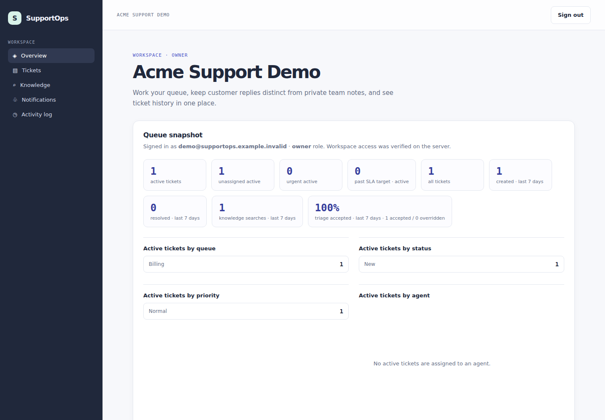
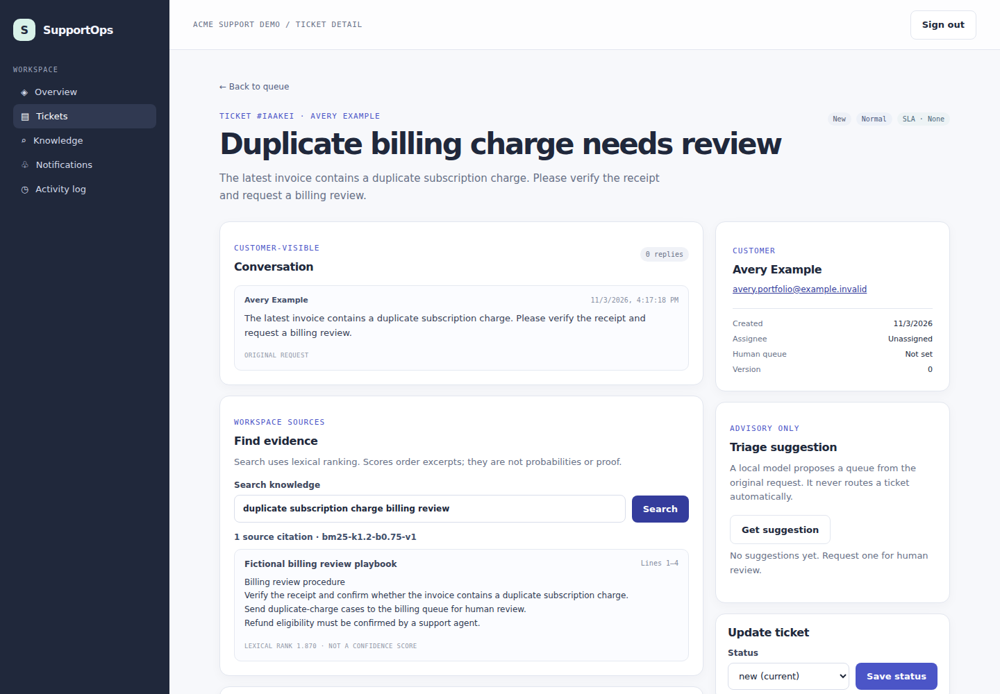
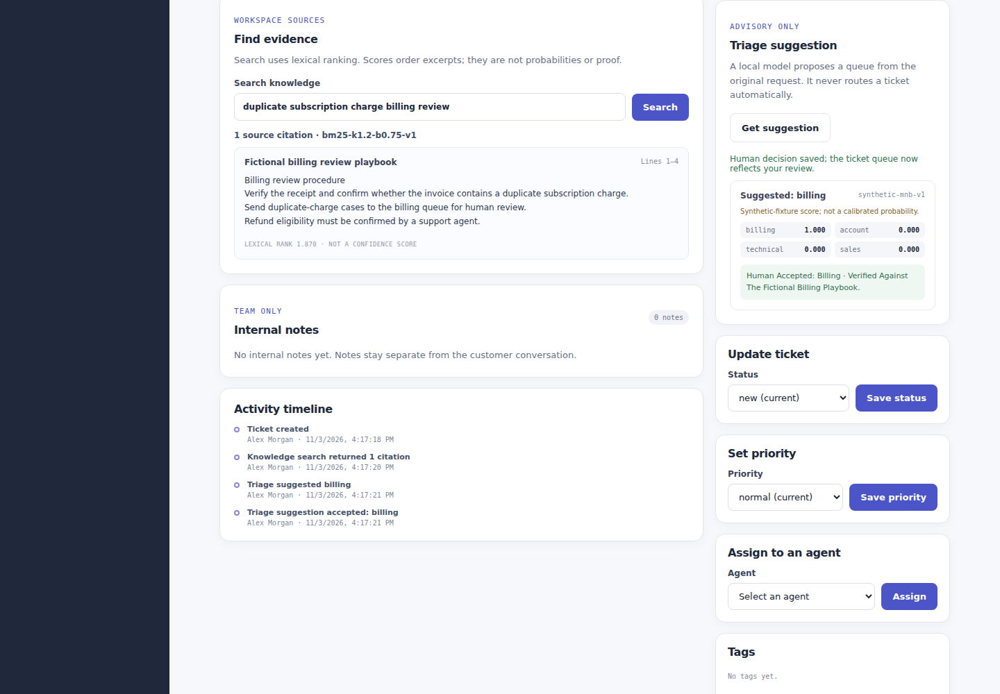

# SupportOps — AI-Assisted Customer Support Platform

A multi-tenant support operations platform for ticket workflows, source-cited knowledge retrieval, human-reviewed ML triage, notifications, audit history, and operational analytics.

> **Portfolio status:** implemented and verified with fictional local/CI data. SupportOps is not publicly deployed, production-approved, or connected to real customer data.

## Why this project matters

Support teams need faster routing and better evidence without giving an automated model authority over customer-impacting decisions. SupportOps keeps retrieval and triage advisory: agents see exact source excerpts, an explicit insufficient-evidence state, and inspectable queue scores before accepting or overriding a suggestion.

Tenant isolation is enforced server-side rather than inferred from navigation. Every workspace operation resolves membership and role before reading or changing tenant-owned data; organization and resource identifiers are never treated as authorization.

## Architecture at a glance

| Component                     | Responsibility                                                                                       |
| ----------------------------- | ---------------------------------------------------------------------------------------------------- |
| Next.js and React             | Authenticated workspace UI, same-origin APIs, authorization and product workflows                    |
| PostgreSQL and Prisma         | Identity, memberships, tickets, messages, notes, knowledge, reviews, notifications and audit history |
| FastAPI and Pydantic          | Private bounded text chunking, lexical retrieval and deterministic local triage                      |
| Better Auth                   | Email/password authentication and database-backed sessions                                           |
| Playwright, Vitest and pytest | Browser, integration, unit and intelligence-service verification                                     |

Request flow:

    Browser → Next.js UI/API → membership and role authorization → PostgreSQL
                           ↘ private token-authenticated FastAPI service

The browser never connects directly to PostgreSQL or the intelligence service. Essential ticket operations remain available when intelligence features are unavailable. See [Architecture](docs/ARCHITECTURE.md) and the [Security threat model](docs/SECURITY.md).

## Product capabilities

- Multi-tenant workspaces with owner, manager and agent roles
- Ticket queues, customers, assignment, priority, tags and validated status transitions
- Separate customer-visible replies and private internal notes
- Bounded plain-text knowledge ingestion with exact line citations
- Explicit insufficient-evidence behavior and lexical-score warnings
- Local triage suggestions with abstention and mandatory human accept/override
- Tenant-scoped notifications and owner/manager-only audit history
- Queue, SLA, workload and seven-day operational metrics
- Reproducible migrations, fictional seed data, CI and container smoke verification

## Product tour

### Source-backed knowledge search

Search results preserve the source title, exact line range and excerpt. Ranking scores order evidence; they are not presented as probabilities or proof.

### Human-reviewed triage

The classifier cannot route a ticket automatically. Its suggestion remains pending until an agent records a human-selected queue and optional reason.

All screenshots were captured by Playwright from a freshly migrated database containing only fictional seed and portfolio fixture data. Run the opt-in capture journey with `CAPTURE_PORTFOLIO_SCREENSHOTS=1`.

## Local quick start

Requirements: Node.js 22+, Corepack/pnpm 10.28.2, Python 3.11+, uv 0.10.11, and PostgreSQL 16+ or Docker Compose.

    cp .env.example .env
    # Replace BETTER_AUTH_SECRET and INTELLIGENCE_SERVICE_TOKEN
    # with unique random values of at least 32 characters.
    corepack enable pnpm
    pnpm install --frozen-lockfile
    pnpm db:generate
    pnpm db:migrate
    pnpm db:seed

Start the intelligence service in one terminal:

    cd services/intelligence
    uv sync --locked --all-extras
    uv run --locked uvicorn supportops_intelligence.main:app       --env-file ../../.env --host 127.0.0.1 --port 8001

Start the web application from the repository root:

    pnpm dev

Open `http://localhost:3000`. The seed-account identifiers and disposable local passwords are defined in `.env.example`. They are public fixture values for an isolated, resettable local environment—never shared-environment credentials.

For the optional containerized local stack, follow [Deployment guidance](docs/DEPLOYMENT.md). The Compose profile is a local verification topology, not a production deployment manifest.

## Verification

| Area              | Coverage                                                                               |
| ----------------- | -------------------------------------------------------------------------------------- |
| TypeScript        | Prettier, ESLint, strict typecheck and production Next.js build                        |
| Unit tests        | Contracts, knowledge schemas, intelligence client behavior and notification visibility |
| Integration tests | Authentication sessions, tenant membership, tickets, knowledge/triage and analytics    |
| Browser tests     | Ticket resolution, authorization, notifications, citations and human-reviewed triage   |
| Python            | Ruff formatting/lint and pytest for health, retrieval, bounds, auth and triage         |
| Security          | JavaScript/Python dependency audits and full-history Gitleaks scan                     |
| Containers        | Compose validation, image builds, migrations, seed, health checks and web smoke test   |

The exact commands, test counts, CI runs, tag target, historical release evidence and remaining verification gates live in [docs/VERIFICATION.md](docs/VERIFICATION.md).

## Deployment and security boundary

SupportOps currently has no public deployment. Before any shared demo or production exposure:

- disable public registration at both UI and API boundaries, or implement verified email, abuse controls and account recovery;
- configure trusted proxy/IP handling, HTTPS, canonical origins and secure cookies;
- keep PostgreSQL and the intelligence service private;
- use managed secrets, reviewed migrations, backups, monitoring, rate limits and retention controls;
- use only fictional, resettable demo data and never run the local seed in a real environment.

See [Deployment guidance](docs/DEPLOYMENT.md) and the [Security threat model](docs/SECURITY.md).

## Documentation

- [Architecture and data flow](docs/ARCHITECTURE.md)
- [Product requirements](docs/PRODUCT_REQUIREMENTS.md)
- [Security threat model](docs/SECURITY.md)
- [Deployment and operations guidance](docs/DEPLOYMENT.md)
- [Verification record](docs/VERIFICATION.md)
- [Architecture decision record](docs/DECISIONS/0001-architecture.md)
- [Changelog](CHANGELOG.md)

## License

No open-source license is granted for this repository. The source is published for portfolio review; reuse, redistribution or derivative use requires explicit permission from the repository owner.
