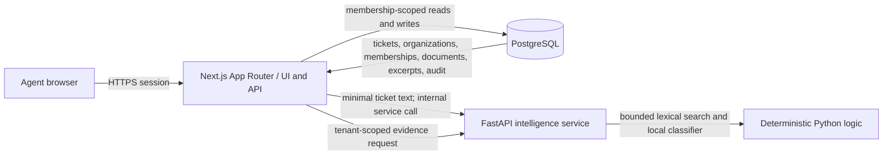

# SupportOps architecture

**Status:** M1–M5 are merged in PRs #2–#6; M5 merge commit `4c8d15c5c33b82e9eef7f1e8bc6bbacb287b8d34` passed main-branch CI run `41416709489`, including container smoke and security scans. The diagram is the system design, not a claim that every component is production-ready or deployed.

## System context



The browser communicates with the Next.js application using same-origin routes and session cookies. Better Auth provides email/password authentication and database-backed sessions; session cookies are HTTP-only and SameSite=Lax. It never connects directly to PostgreSQL or the intelligence service. Next.js is the sole authority for identity, tenant selection, authorization, and persistence. Email verification and outbound message delivery are not configured; ticket replies are stored in the customer-visible conversation but are not emailed. Public registration is not production-ready. The internal FastAPI service is stateless with respect to identity; its private routes require a shared bearer token and are intended for the local/container network. Its public liveness endpoint returns no tenant data. The web server calls it server-to-server and sends only the minimum text and bounded, workspace-scoped evidence needed for a request. CI uses local synthetic data and must not require paid services or downloaded model weights.

## Monorepo layout

```text
apps/web/                 Next.js App Router, React, TypeScript, Tailwind
services/intelligence/    FastAPI, Pydantic, deterministic local ML/retrieval
packages/database/        Prisma schema, generated client, migrations, seed
packages/contracts/       Shared API types/schemas where runtime sharing is appropriate
packages/ui/              Accessible reusable UI primitives
infra/docker/             Local PostgreSQL and service orchestration
docs/                      Product, architecture, security, decisions, operations
```

Use the pnpm 10.28.2 lockfile-driven JavaScript workspace plus the `uv.lock` Python dependency lock. The foundation currently pins Next.js 16, React 19, Prisma 6, Better Auth, PostgreSQL 16 for local/CI, and FastAPI/Pydantic. Keep the number of tools and runtime services small. Avoid duplicating generated Prisma artifacts or hand-maintaining parallel API schemas: OpenAPI can be generated from FastAPI and consumed/generated types can be checked in a later milestone if the boundary warrants it.

## Request and data flow

1. A request reaches a same-origin Next.js route or server-rendered page. The auth library validates the session.
2. A shared server-side authorization helper resolves an active organization only from the user's membership records and checks the required role. Missing membership and unauthorized resource access use non-enumerating responses.
3. The route validates input with Zod, bounds pagination/search/upload fields, and invokes a domain service. The service scopes every tenant-owned lookup and mutation by the authorized `organizationId`; resource IDs alone never authorize access.
4. Prisma executes the operation in PostgreSQL. Ticket and knowledge changes, their audit event, and any resulting assignment/mention notifications are written transactionally. Dashboard aggregates read only the authorized workspace and use indexed counts/groupings; the assignment workload list is capped at 500 active assignments. Records carry `organizationId` directly where applicable so scope is explicit and indexable.
5. For triage or search, Next.js calls FastAPI with a narrow internal request and timeout. A service outage means “review manually” or an explicit retriable search error; ticket creation and editing do not depend on intelligence availability.
6. FastAPI validates input via Pydantic and returns typed suggestions/evidence. It does not decide ticket state, assign staff, write to PostgreSQL, or treat its scores as certainty. Next.js verifies provenance and persists suggestion/review records.
7. The UI renders internal notes only in an authenticated agent view and labels them distinctly. Customer-facing response paths select public messages by construction.

## Data model outline

All rows that belong to a workspace include `organizationId`, or are reached only through a parent relation that has an explicitly checked organization. Use composite uniqueness/foreign-key constraints where practical to prevent mismatched tenant references (for example, assignment's ticket and agent membership must match the same organization). The Prisma schema and migrations will make the final relationships authoritative.

- **Identity:** `User`, `Organization`, `Membership` (`owner|manager|agent`), optional invitation state.
- **Support:** `Customer`, `Ticket`, `TicketMessage` (customer-visible reply record; no outbound email delivery), `InternalNote`, `Assignment`, `Tag`, ticket/tag join, and activity timeline.
- **Knowledge:** `KnowledgeDocument`, `KnowledgeChunk` (bounded excerpt, lexical metadata, exact line/page provenance); deletion cascades to indexed excerpts.
- **Human-supervised ML:** `ClassificationSuggestion` (suggested queue, score map, model/version, gate outcome), `Citation` (suggestion/search-to-chunk provenance), explicit human review decision/override.
- **Operations:** `AuditEvent`, `Notification`. Notifications contain minimal assignment/mention summaries and are queried by the recipient's tenant membership; mention handles resolve only to workspace members, and recognized email handles are replaced with “a teammate” in the stored customer-visible reply. Audit events store action/target/summary and bounded metadata, never message/document bodies; owner/manager UI and API reads are tenant-scoped. Dashboard aggregates are live counts (including a 7-day window for activity/review/search measures), not historical snapshots or performance benchmarks.

Audit rows are append-only by application convention; ordinary mutation endpoints never update/delete them. This is not a claim of tamper-proof storage. Timestamps are UTC. Tenant-owned queries and child-record writes verify all referenced entities belong to the same organization.

## Retrieval and triage choices

- Initial retrieval is bounded BM25 lexical ranking over at most 500 newest workspace excerpts per request, returning at most five exact line-cited snippets. The ranker uses version `bm25-k1.2-b0.75-v1` and omits scores below the documented implementation gate of 0.15; this is a conservative relevance floor, not a calibrated support probability. An empty result is labeled “insufficient evidence.” The interface must say “lexical search”; no embedding/vector dependency is planned for M3.
- M3 ingestion accepts at most 32,000 characters and 5,000 source lines as plain text, chunks excerpts at 900 characters, and records original line coordinates. PDF, upload, OCR, and external-connector ingestion remain out of scope. The original document and chunks are tenant-scoped; deletion cascades to chunks and saved citations.
- The existing `evidence-search` project demonstrates a useful pattern: retain source line coordinates through chunking, return inspectable excerpts, and separate a ranking score from answer correctness. SupportOps will reimplement the minimal domain-appropriate interface rather than importing the project wholesale.
- The M3 triage baseline is a deterministic multinomial Naive Bayes classifier fit in code on 20 tiny, synthetic examples across `billing`, `account`, `technical`, and `sales`. It abstains below known-token coverage 0.20, top score 0.52, or top-two margin 0.12. These uncalibrated synthetic-fixture scores and hand-selected gates are not validated performance or correctness estimates. Only the original ticket subject/description is classified; replies and internal notes are excluded. Each suggestion remains separate from `Ticket.queue` until an agent explicitly accepts or overrides it; review state, reviewer, time, optional reason, and activity are persisted. The existing `ticket-triage-classifier` project demonstrates train-only feature fitting, an abstention path, and explicit warnings for tiny synthetic evaluations. Its implementation/data are not copied into this repository.
- `paper-evidence-retrieval` demonstrates page-level provenance and conservative evidence presentation. SupportOps will apply provenance and abstention principles to its own bounded document format, not copy its code, artifacts, or corpus.
- M3 implements these methods and versions in code and this document. They are an initial inspectable baseline, not a benchmarked or calibrated model. Tests use synthetic fixtures only; no external model downloads or paid services are used.

## Failure and scaling boundaries

PostgreSQL is the source of truth. The web app must continue essential ticket operations if FastAPI is unavailable. Intelligence requests have timeouts, bounded payloads, generic client-facing failures, and redacted structured logs. Indexes will cover organization plus common ticket filters and document lookup. Avoid premature Redis, a queue, object storage, or vector database; revisit only with a demonstrated scale or durability requirement. Do not perform CPU-heavy/unbounded PDF parsing in the web process. Upload support must be separately threat-reviewed and size/page bounded before enabling.

## Verification strategy

- Prisma schema validation and migration from an empty PostgreSQL database.
- Service-level authorization tests, including cross-organization guessed-ID reads/writes and related-entity mismatches.
- Transaction tests for state transition plus audit write, assignment and SLA calculation, and deletion of document excerpts.
- FastAPI Pydantic/contract tests and deterministic local classifier/retrieval tests for abstention and citation provenance.
- Browser journey against seeded local services; no paid APIs or internet-dependent tests.
- CI runs format/lint, type-check, unit/integration tests, Python tests and production builds from lockfiles.
